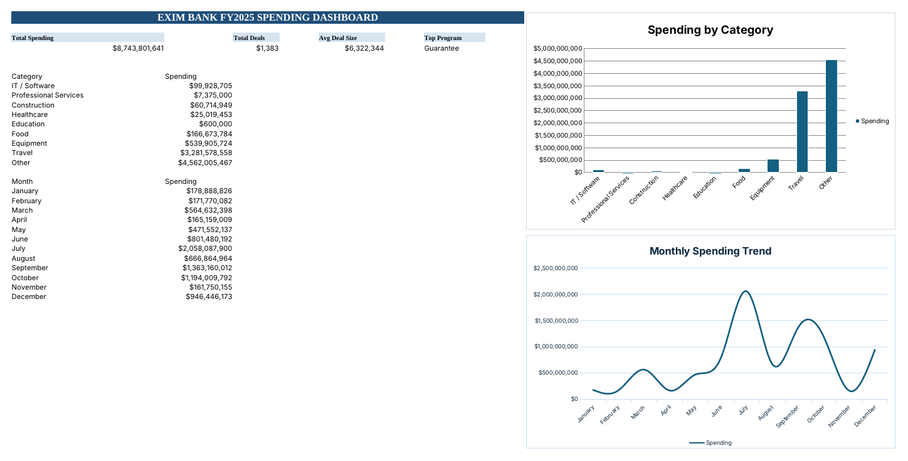

# EXIM Bank Lending Analysis (Excel)

Excel capstone for Management Information Systems at Rutgers Business School (Spring 2026). I took the public record of every U.S. Export-Import Bank (EXIM) authorization since October 2006, cleaned it in Excel, and built a dashboard and recommendations for fiscal year 2025.

## FY2025 at a glance

| Total approved | Deals | Average deal | Largest program |
|---|---|---|---|
| $8.74B | 1,383 | $6.3M | Guarantee ($3.86B) |

## How I built it

1. **Prepare.** Imported the data.gov CSV, removed blanks and duplicates, and formatted dates, currency and text. The cleaned sheet has 52,000+ rows. I added Year, Quarter and Month columns, plus a derived **Category** column that groups free-text product descriptions into nine sectors (Travel, Equipment, Food, IT / Software and others).
2. **Explore.** Totals, counts and average deal size by country, program and month, using SUMIFS, COUNTIFS and IFERROR.
3. **Classify.** Used nested IF formulas against a thresholds table to tag each country's 2025 spending as High (at least $10M), Medium (at least $1M) or Low, with conditional formatting on the top values.
4. **Pivot.** Three PivotTables with slicers: country by category, monthly spending, and country by product.
5. **Visualize.** A category bar chart, a monthly trend line and a program pie chart, combined into a one-page dashboard with KPIs.

## What I found

- **Two banks in one.** The Guarantee program carries the dollars: 137 deals worth $3.86B, mostly aircraft and infrastructure. The Insurance program carries the volume: 1,135 smaller deals worth $2.46B, many supporting small, women-owned and minority-owned exporters.
- **Aviation dominates.** Travel is $3.28B of FY2025 approvals, far ahead of Equipment at $0.54B. Healthcare and Education are each well under 1%.
- **A data-quality gap.** About $4.56B, over half the year's total, falls under "Other" because the product descriptions are too vague to classify.
- **Lumpy timing.** July alone carried $2.06B. Approvals also jump in March, June, September and December, the ends of EXIM's fiscal quarters, which suggests a deadline rush.
- **Where the money goes.** Apart from multi-country deals, the largest destinations were the United States, Turkey and Malaysia.

## Recommendations

1. **Fast-track renewals** for repeat Insurance customers with a clean record, so underwriters can focus on large, complex deals.
2. **Replace free-text product descriptions with a dropdown,** which would shrink the $4.56B "Other" bucket and make reporting reliable.
3. **Diversify away from aviation** into sectors like healthcare and education, so one bad year in travel does less damage.
4. **Encourage earlier submissions** in each quarter to smooth the quarter-end workload.

## Files

- `PurushothamanEswar_SushantElango_Excel_Capstone.xlsx`: the full workbook (cleaned data, analysis sheets, PivotTables and dashboard)
- `dashboard.pdf`: the dashboard sheet as a one-page PDF

**Data:** [EXIM Bank authorizations, data.gov](https://catalog.data.gov/dataset/authorizations-from-10-01-2006-thru-12-31-2022) · **Tools:** Microsoft Excel

---
Sushant Elango · [sushantelango.com](https://sushantelango.com)
